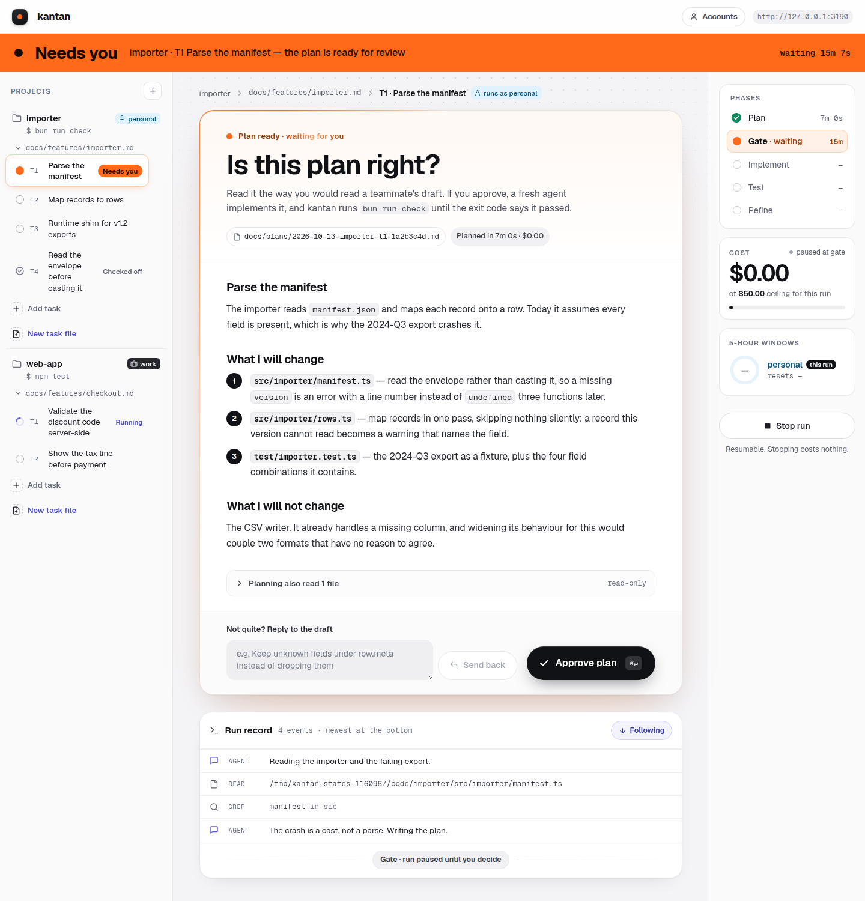
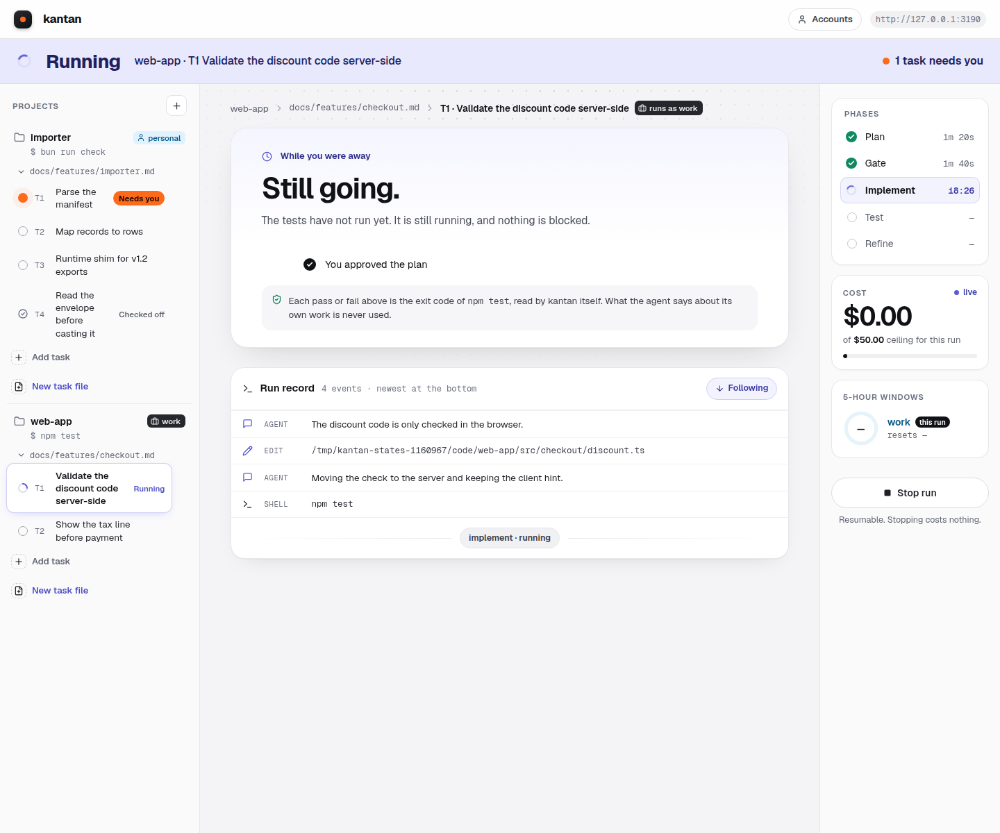
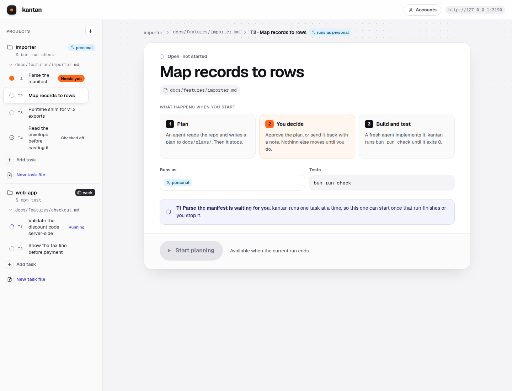
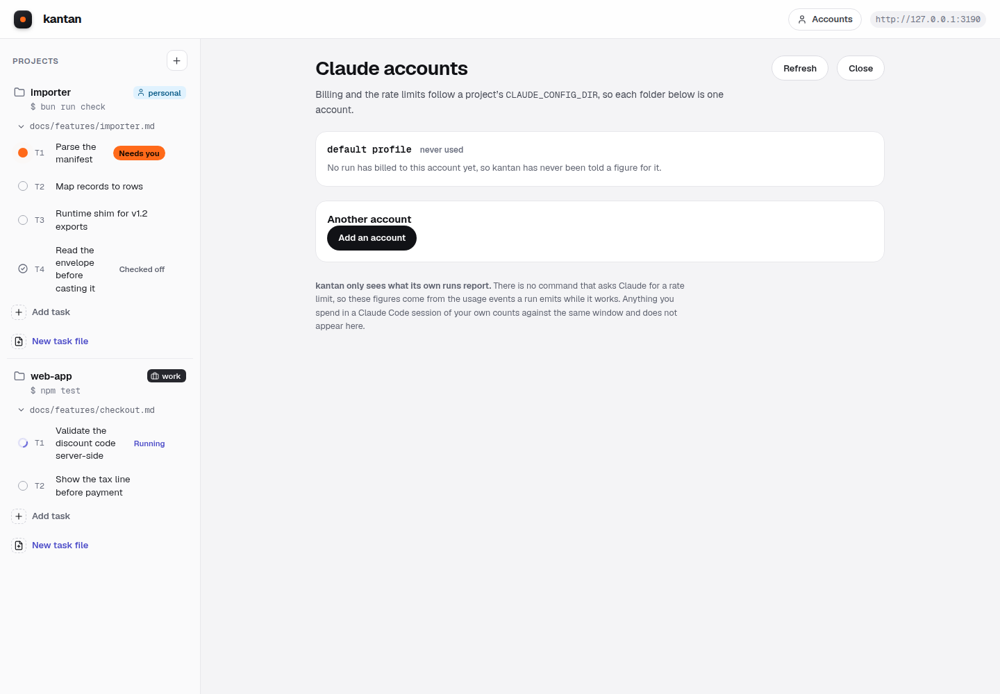
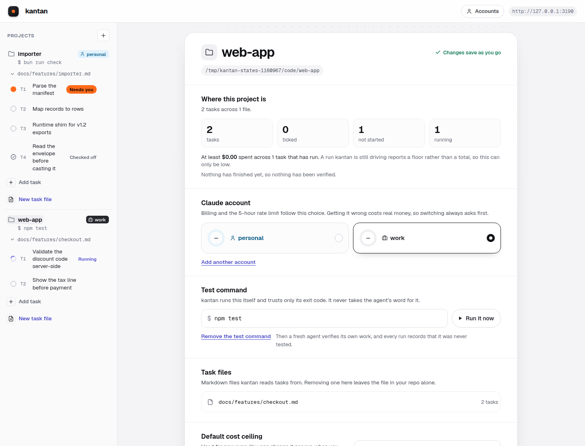

# kantan

**簡単** *kantan*: simple, brief.

A local web UI that drives the real `claude` CLI through one coding task at a time:
plan, you approve, then implement and test until the tests pass.

> **Status: it works, and it is rough in places.** The pipeline runs end to end — plan,
> gate, implement, test, commit — against the real `claude` binary, from one process on one
> port. 75 modules, 2591 tests, one of them skipped. [Rough edges](#rough-edges) lists what is still unfinished,
> by name, including the parts that are merely hidden rather than done.
>
> The hard-won facts about `claude -p` are in [`docs/probes/`](docs/probes/), and every
> script there is rerunnable, so you can check rather than trust.



*The gate. An agent read the repo and wrote this plan, then stopped. Nothing else
moves until you approve it or send it back with a note.*

## What this is not

Read this part first, because it is the whole design.

- **No agent org chart.** No CEO, CTO or specialist personas.
- **No autonomy.** Nothing wakes itself up. No heartbeats, no routines, no schedulers.
- **No multi-agent orchestration.** One task, one session, one human. If you want a fleet of
  agents negotiating with each other, this will disappoint you, deliberately.
- **No tracker database.** Your backlog is markdown in your own repo, in your own git history.
- **No worktree sprawl.** One branch per task, one active run per project.

Every one of those is a reaction to a tool that started well and drifted. The ceremony tends
to grow faster than the usefulness.

## How it works

```
 plan --> [YOU APPROVE] --> implement --> test --> done
             |                             |
        feedback                    fail, and keep going
             +--> plan                     +--> refine --> test
```

It spawns the real `claude` binary. It does not reimplement an agent loop, so your
`CLAUDE.md`, skills, plugins, hooks, settings and auth all load exactly as they do in your
terminal. There is nothing to port and nothing to configure twice.

Four nouns, three of which already exist on your disk:

| Noun | Is actually | Lives in |
|---|---|---|
| Project | a repo directory, a test command (or none), a profile | `~/.kantan/projects.json` |
| Feature | a markdown file | `<repo>/docs/features/<slug>.md` |
| Task | a `- [ ]` line in that file | the same file |
| Run | one task through the pipeline | `~/.kantan/runs/<uuid>.jsonl`, raw stream-json |

**Your run logs are raw stream-json, and that means prompts, tool inputs and file
contents.** `~/.kantan/runs/<uuid>.jsonl` is what the CLI emitted, byte for byte, because
replaying it is what makes the UI reconnectable. So read one before you attach it to a bug
report: it can contain source from the repository the run was working in, and anything your
`CLAUDE.md` or a skill put into a prompt. Nothing is sent anywhere — kantan binds loopback and
talks to no service — but the file is yours to share by accident.

**The server runs your tests, not the agent.** It branches on the exit code and never on the
agent reporting success. Verification from outside the agent cannot be talked out of.

With one exception, and it is stated here rather than buried because it changes what a green
result means. A project may declare **no test command**: most repositories have none, and
requiring one excluded them. Those runs are verified by the agent checking its own work, which
is a weaker claim — so kantan records which of the two happened in the run log, and **no screen
prints an exit code, a tick or the word "passed" for a run that checked itself**. A log written
before that field existed reads as "unknown", never as a pass. If a surface cannot tell you
which kind of verification it saw, it does not get to imply either.

## Running it

```bash
git clone https://github.com/laithalenooz/kantan && cd kantan
curl -fsSL https://bun.sh/install | bash     # standalone, not via npm
bun install
bun run check                                # typecheck and tests, to prove the clone works
bun run build                                # the interface, into dist/ — needs Node
bun run server                               # one process, on 127.0.0.1:3100
```

Open <http://127.0.0.1:3100>. `ORCH_PORT` moves it.

Bun runs the server and the tests. **Node is needed for one step only — `bun run build`,
because Vite needs it.** Install Bun standalone rather than through npm: a Bun under an
nvm-scoped npm prefix disappears from `PATH` the moment you change Node versions.

If you skip `bun run build`, the server still starts and the page tells you so rather than
404ing on its own index — a fresh clone having no build is the normal state, not an error.

Two things you will need: the `claude` CLI on your `PATH`, already logged in, and a repo with a
`docs/features/<slug>.md` holding `- [ ] T1 ...` lines. Point kantan at the repo from the empty
state and it will read the task file.

**If you used this before it was called kantan**, it kept its state in `~/.orch` and named its
branches `orch/<task>`. Nothing moved: kantan reads `~/.orch` when it exists and `~/.kantan` does
not, and says so at startup with the one command that moves it. `KANTAN_PORT`, `KANTAN_DEV` and
`KANTAN_CLAUDE_BIN` are the names now, and the `ORCH_*` spellings still work. Branches an
interrupted run left under `orch/` are still recognised and still resumable; new ones are
`kantan/<task>`.

### Working on kantan itself

```bash
bun run server:dev                           # the orchestrator, on 127.0.0.1:3100
bun run ui                                   # Vite, with HMR, on 127.0.0.1:5173
```

Open <http://127.0.0.1:5173>. Use `server:dev`, not `server`: Vite proxies `/api` to 3100 and
deliberately does **not** rewrite the `Host` header, because rewriting it would hide the browser's
real one from the DNS-rebinding check. So the server sees `Host: localhost:5173` and refuses it
unless `ORCH_DEV=1` has widened the allowed set, which is all `server:dev` does.

## What it looks like

<table>
<tr>
<td width="50%"><a href="docs/screenshots/running.png"></a></td>
<td width="50%"><a href="docs/screenshots/start.png"></a></td>
</tr>
<tr>
<td><b>Running.</b> The phases, the live cost against this run's ceiling, and every
event the CLI emitted. The note under the digest is the whole design in one
sentence: the pass or fail is the exit code of <i>your</i> test command, read by
kantan, and what the agent says about its own work is never used.</td>
<td><b>One task at a time.</b> This task cannot start, and the panel says why
rather than greying a button out: another run is in flight, and kantan runs one
per project so two agents can never share a working tree.</td>
</tr>
<tr>
<td><a href="docs/screenshots/accounts.png"></a></td>
<td><a href="docs/screenshots/overview.png"></a></td>
</tr>
<tr>
<td><b>Accounts.</b> Which Claude account each project bills to, and where its
rate-limit windows stood the last time kantan saw. It says "last seen" and "window
reset" rather than drawing a stale bar, because there is no command that asks
Claude for a rate limit.</td>
<td><b>Nothing selected.</b> Three steps, and the vocabulary is the whole model: a
repository, a task file, a task.</td>
</tr>
</table>

Every one of those is the real UI. They are taken by
[`docs/probes/states.ts`](docs/probes/states.ts), which boots an ordinary kantan
against a scratch home — real git repositories, real task files, run logs written
through the same writer a real run uses — so a screenshot costs nothing and no
state has to be reached by paying an agent to get there.

## Permissions, and what kantan grants an agent

An unattended agent needs real tool access: it runs its own tests and commits its work. So this
is per-project configuration, and the default is **derived from what you already declared**
rather than guessed:

| Granted by default | Why |
|---|---|
| `Edit`, `Write`, `Read`, `Glob`, `Grep` | implementing and reading the repo |
| `Bash(git *)` | the agent commits on the task branch |
| `Bash(<your testCmd> *)` | TDD runs the suite it is writing against |

A project with no test command gets the first two rows and nothing more. Nothing else. No network, no package installs, no arbitrary shell. `bypassPermissions` is
available if you want it on your own machine, but it is not the default, because a default that
hands blanket shell access to a stranger's repo is the wrong default no matter how convenient it
is for the author.

A denied tool shows up in the UI by name, so the fix is a line of config rather than a debugging
session.

## What we learned about `claude -p`, so you do not have to

These cost real money to discover. Every script in [`docs/probes/`](docs/probes/) is
rerunnable, so you can check rather than trust.

- **`AskUserQuestion` does not exist in `-p` mode.** The agent asks in prose and exits
  `subtype: success`, so a question and a completion are indistinguishable by message type.
  Never infer completion from exit status. kantan requires a sentinel line instead.
- **`--max-budget-usd` bounds one process, not your run.** Cost resets on every `--resume`,
  so a ceiling set per process silently restarts at each gate. Track the total yourself and
  pass `ceiling - spent`.
- **`--resume` accepts a different `--effort`** and keeps context, which makes effort
  escalation on failure possible. It needs a respawn, since `--effort` is set at spawn time.
- **Hook events flood the stream.** Roughly twenty `system/hook_*` messages arrive before the
  first real one. Filter at parse.
- **`rate_limit_event` carries `overageStatus: "rejected"` on every normal event** when
  overage is disabled for the org. Key a warning on `status`, not on that field, or it fires
  constantly.
- **Switching models inside one conversation is a trap.** It cold-starts the prompt cache and
  drops thinking blocks the new model cannot read. Switch between conversations instead.

## Rough edges

Listed rather than hidden, because every one of these is something you could hit in an
afternoon and wonder whether you had broken it.

- **The account-usage view only sees what kantan's own runs reported.** There is no usage
  subcommand on the CLI to ask, so the figures come from `rate_limit_event` messages found in
  past run logs. Between runs it can only tell you what it last saw and when — and it says
  so, in those words, rather than drawing a stale bar. If you have been using `claude` in
  your terminal, kantan does not know about it.
- **A second Claude account has to be named by hand, once.** The accounts screen scans your
  home directory for folders that look like profiles — the test is a `.credentials.json`
  inside them, not the name, because a plugin's `~/.claude-mem` matches every name-based
  rule — and then asks you what to call it and whether it bills as personal or work. It will
  not guess the last part: billing a client from the wrong account is the mistake the whole
  design is arranged to prevent. A profile kept outside your home directory is not found, and
  you paste its path instead.
- **`src/run.ts` is 2817 lines.** It is one state machine, and that is measured rather than
  excused: most of its functions mutate the same `ActiveRun`, so a split would be two files
  sharing mutable state instead of one file holding it. The two groups that *were* separable
  came out, into `src/run/ladder.ts` and `src/run/session.ts`.
- **One JS bundle, 741 KB, no code splitting.** Fine on loopback, which is the only place
  this runs. Vite says so on every build.
- **A future CLI event will render as raw JSON for a while.** That is the designed failure
  direction rather than a bug — an event this version does not know becomes a visible
  `unknown` row with its JSON selectable, instead of being dropped — but it does mean the log
  will show you a blob the first time Anthropic adds a message type. Tell us, and it gets a
  row of its own, as `system/vcs_state_changed` did.
- **The implementation plan is history, not a status board.** It is the decomposition the
  project was built from and the task descriptions are still worth reading;
  [`docs/HANDOFF.md`](docs/HANDOFF.md) is the file that records what is true now, and
  [`docs/features/kantan.md`](docs/features/kantan.md) is the live backlog.

## Two warnings worth reading

**The stream-json shape depends on the CLI version.** These findings were probed against
Claude Code `2.1.296`. kantan records `claude --version` in every run log for that reason. On
a version bump, rerun the probes before trusting any of it.

**The server is not a public service.** It binds `127.0.0.1` and checks `Host`, `Origin` and a
per-launch token, because its endpoints feed arbitrary text to an agent with tool access. Do not
expose it, and do not remove those checks to make a reverse proxy work.

## Design

- [Design](docs/plans/2026-10-11-orchestrator-design.md), with every probed claim marked.
- [Implementation plan](docs/plans/2026-10-11-orchestrator-implementation.md), 32 TDD tasks.

## Licence

MIT. See [LICENSE](LICENSE).
